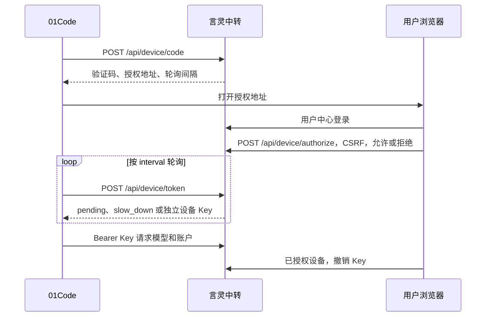

# NIM Rust Gateway

OpenAI 与 Anthropic 兼容网关。聚合 NVIDIA NIM 与任意 OpenAI 兼容上游，单文件二进制，web 控制台内嵌，无运行时依赖。

## 功能

- 账号池调度：LRU 轮换、按「渠道 + 模型」成功率路由、新账号预热、模型不存在负缓存
- 限速与保护：账号 RPM / TPM / 日限额、渠道并发上限、分级冷却、错误分类、模型熔断、失败封禁阶梯
- 请求处理：失败自动换号重试、429 吸收、同号快速重试、无可用账号时排队等待
- 流式：SSE 逐块透传，慢推理模型心跳保活，首字节超时与空闲超时独立控制
- 协议：OpenAI Chat / Completions / Embeddings / Responses 与 Anthropic Messages，含流式事件转换
- 多用户计费：用户与调用 Key（可限定免费 / 付费 / 全部模型）、按次 / 输入输出 token / 输入长度档位定价、并发额度预占、用户级限速、调用日志与模型广场
- 模型广场：价格与免费标记、上下文 / 速度标注、最近 10 次请求热力图（绿=成功，黄=重试后成功，红=失败，灰=无数据）
- 账本：赠金与充值分离记账，计费优先扣赠金；累计调用与累计消费按用户持久累计（不受日志裁剪影响）
- 每日签到：可选开启，赠金与余额统一入账
- 管理后台：账号、渠道、限额、日志、排队、拦截规则、训练资料、用户、模型接入与定价、配置导入导出；模型接入页带概览统计，渠道与模型行展示最近 10 次请求热力图
- WebClaw：在浏览器运行 Agent 工具循环，支持本机文本文件、目录读写确认与文件下载；模型推理通过网关
- 自动更新：GitHub Releases 正式版，手动触发或定时自动检查，带备份与一键回滚

## 构建

使用当前 Rust stable 工具链与仓库中的 Cargo.lock 构建。

```bash
cargo build --locked --release
```

产物：`target/release/nim-gateway`（Windows 为 `nim-gateway.exe`）。

## 运行

```bash
./run.sh          # Linux / macOS
run.bat           # Windows
```

默认端口 8100。首次启动在控制台打印随机生成的管理员密码，访问 `http://127.0.0.1:8100/admin` 登录。

| 环境变量 | 说明 | 默认 |
|---|---|---|
| `NGW_PORT` / `PORT` | 监听端口 | 8100 |
| `NGW_DATA_DIR` | 数据目录（db.json 所在位置） | `./data` |
| `NGW_ADMIN_PASSWORD` | 启动时同步管理员密码；密码变化时使旧会话失效 | 首次启动随机生成 |
| `NGW_UPDATE_URL` | 自建更新源 | GitHub Releases |
| `NGW_UPDATE_REPO` | 更新仓库名 | `Cheerimy-Studio/NIM-Rust-Gateway` |

忘记后台密码：`nim-gateway --reset-password 新密码`。

## 自动更新

更新源是本仓库的 GitHub Releases，只有正式 Release 会触发更新。发布新版本：

```bash
git tag v1.7.1 && git push origin v1.7.1
```

CI 自动构建 Linux（glibc 2.17）与 Windows 二进制并发布 Release。实例侧两种方式：

- 手动：后台「检查更新」按钮
- 自动：设置里将「自动检查更新间隔」设为 N 小时（0 关闭）

更新流程：下载、备份到 `backup/`、原子替换、自动重启。回滚备份保留一份，可在后台一键回退。

## 数据存储

数据按表分文件存放于 `data/db/`，落盘只写有变化的表（账号、日志、训练资料互不影响，
不会因为一条日志重写整个库）：

```
data/db/config.json       配置与渠道预设
data/db/keys.json         账号池
data/db/upstreams.json    渠道
data/db/logs.json         请求日志
data/db/training.json     训练资料
data/db/sessions.json     会话审计
data/db/intercepted.json  拦截记录
data/db/queue.json        排队
data/db/metrics.json      统计、限速窗口、熔断与负缓存
data/db/users.json        用户、调用 Key、调用日志、限速窗口
data/db/signs/            旧版每日签到记录，新签到标记与余额同存 users.json
data/db/reward_journal.json 奖励事务恢复日志，仅在提交与写回之间存在
```

从旧版单文件升级：首次启动自动拆分迁移，原 `db.json` 改名 `db.json.migrated` 留存。
更新/回滚会整目录备份与还原数据。

## 验证与流式行为

```bash
cargo test --locked --all-targets
node tests/frontend-console.cjs
node tests/frontend-webclaw.cjs
node tests/frontend-webclaw-send.cjs
python tests/webclaw_e2e.py
python tests/console_e2e.py
python tests/billing_e2e.py
node tests/frontend-user-init.cjs
```

浏览器回归需要 `pip install -r requirements-dev.txt` 和 `python -m playwright install chromium`，
然后执行 `python tests/console_e2e.py --ui`。全部接口测试使用临时数据目录。
前端样式、脚本与图标已内嵌，页面无需连接外部 CDN。模型广场支持搜索、价格筛选与直接进入对话测试。

测试覆盖跨网络分块的 UTF-8 / CRLF、工具调用转换、异常断流、真实 usage、
成功调用计费、客户端断连释放、并发排队上限、签到目录备份与多用户日志迁移。
CI 在 Linux 和 Windows 上运行测试。

流式响应以完整 SSE 事件为单位转发，单事件上限为 1 MiB（不是整个回复的上限）。
真实 usage 优先；缺失时仅对生成内容估算。收到 `[DONE]`，或在所有 choice 都有
`finish_reason` 且没有残缺事件时关闭连接，才视为正常结束。中断、错误事件与残缺
JSON 会返回协议对应的流内错误，记为失败且不扣费。网关不会依据中英混排密度或
正文中的特殊 token 示例判定“乱码”而截断回复。

## WebClaw 测试台

`/webclaw` 是独立的模型测试页，**后台与用户中心共用同一个页面**：从后台侧栏「数据 → WebClaw 测试台」
或用户中心「对话测试」进入。身份由服务端判定，同一份前端按身份切换行为。

- **管理员**：取后台配置的访问令牌，模型来自 `/v1/models` 与渠道配置。
- **普通用户**：页面自动取自己名下的测试 Key（`sk-usr-`），模型只来自模型广场，
  调用计入本人的余额与限流；页面不会读取任何后台配置。
- 两种身份都用本页自己的会话校验：后台看 `ngw_session`，用户看 `ngw_user`；
  都没登录时跳回 `/user` 登录。
- 项目按身份分键存放（`webclaw.projects.v1::<身份>`），同一台机器换账号不会看到上一个人的对话。

- **项目式对话**：左侧维护多个项目，每个项目独立保存模型、系统提示、流式开关与完整对话；
  可新建、切换、重命名、删除。
- **完全本地**：项目存在浏览器的 `localStorage`，不上传网关。
  换设备或清缓存前请先导出。
- **一键导出**：侧栏「导出全部」把全部项目导成一个文件；「导出项目」只导当前项目。
  文件名形如 `webclaw-<项目名>-<YYYYMMDD-HHMM>.json`，项目名里的路径字符会被替换。
- **导入**：支持整包、单个项目、裸数组与单对象四种输入；可选「合并」或「覆盖」。
  导入一律重建内部 id，重名会自动加「（导入）」「（导入 2）」后缀直到唯一。
- **流式**：按完整 SSE 帧解析（CRLF / LF / CR 三种行尾都认），上游不发末尾空行时
  最后一帧仍然计入；可随时「停止」中断。
- **诊断**：每次请求显示状态码、首字节、总耗时、token、事件数、模型映射与原始事件流。

文件格式（`version` 固定为 1，`kind` 区分整包与单体）：

```json
{
  "app": "webclaw",
  "version": 1,
  "kind": "bundle",
  "exported_at": "2026-11-01T05:30:00.000Z",
  "projects": [
    {
      "name": "默认项目",
      "model": "mock-model",
      "system": "",
      "stream": true,
      "created_at": 1761975000000,
      "updated_at": 1761975000000,
      "messages": [
        {"role": "user", "content": "你好", "reasoning": "", "err": "", "at": 1761975000000},
        {"role": "assistant", "content": "你好！", "reasoning": "", "err": "", "at": 1761975001000}
      ]
    }
  ]
}
```

导入时不接受 `user` / `assistant` 以外的角色，空消息会被丢弃；未完成的请求不会写进文件。

## 独立选择上游接口

在管理后台「上游」中设置「发送到上游的接口」。`Base URL` 仍只填公共前缀，例如 `https://api.example.com/v1`，不附带具体端点。

| 渠道 `api_endpoint` | 实际上游对话接口 |
|---|---|
| `chat/completions` | `/chat/completions` |
| `responses` | `/responses` |
| `messages` | `/messages` |
| `completions` | `/completions` |
| `auto` 或旧配置缺失此字段 | 保留旧行为：对话走 Chat，文本补全走 Completions |

明确选择接口后，下游可继续调用 Chat、Responses、Messages 或字符串 prompt 的 Completions；网关转换请求、JSON 响应和 SSE 事件。Embeddings 是独立任务，始终调用 `/embeddings`，不会转换成对话；对话、旧版文本补全与向量的负缓存、熔断状态相互隔离。

渠道 `auth_mode` 可选择 `auto`、`bearer`、`x-api-key`。自动模式按**上游**协议选择：Messages 使用 X-API-Key，其余接口使用 Bearer；始终使用渠道账号密钥，不转发下游的鉴权信息。Messages 同时携带 `anthropic-version: 2023-06-01`。不跟随上游重定向。

```json
{
  "name": "Responses 渠道",
  "base": "https://api.example.com/v1",
  "api_endpoint": "responses",
  "auth_mode": "bearer",
  "enabled": true
}
```

固定参数按**选定上游协议**的字段名填写，例如 Responses 的 `max_output_tokens`、Messages 的 `max_tokens`；`model` 与 `stream` 由路由控制。每次重试从原始请求构建，不继承其他渠道的固定参数。修改渠道路由配置会清理旧的负缓存与熔断状态；升级首次启动也会清理旧的未隔离状态。

适配支持常见文本、函数工具、Chat/Responses/Messages 图片输入和 usage。旧版 Completions 使用角色文本拼接 prompt，没有通用的结构化角色隔离，不支持工具或图片。对于要求系统角色隔离的任务，应使用其他三种上游。

这是无状态的协议适配，不是任意原生 API 透传。`previous_response_id`、后台任务、Responses 服务端内置工具、音频/文件内容、带签名的 Messages 思考历史等不能安全转换的功能会明确拒绝。某些协议没有等价参数，例如 Responses 的 stop/seed、Messages 的 JSON 格式或 strict 工具约束，网关会报错，避免静默丢弃要求。Responses/Messages 不支持跨协议 `n>1`。

非流式上游响应（含解压后的错误体）上限 20 MiB；SSE 仍按单事件 1 MiB 限制。API 请求和上游响应必须为有效 UTF-8。

## 接口

```
POST /v1/chat/completions      流式 / 非流式
POST /v1/completions
POST /v1/embeddings
POST /v1/responses             含流式事件转换
POST /v1/messages              Anthropic，含流式事件转换
GET  /v1/models、/v1/models/{id}
GET  /admin                    管理后台
GET  /webclaw                  WebClaw 测试台（后台 / 用户中心共用）
GET  /user                     用户中心
GET  /queue                    公开排队页
```


鉴权：用户在用户中心生成 API Key（`sk-usr-` 前缀），`Authorization: Bearer <Key>` 调用；也可在后台生成访问令牌。旧版奖品 Key 已停用。

## 许可

[AGPL-3.0](LICENSE)

## 签到

签到标记、赠金和流水在同一事务内提交，启动时先恢复未完成的提交日志。
旧版每日签到文件继续读取，损坏时拒绝重复入账。日期按服务进程本地时区计算，
使用北京时间时设置 `TZ=Asia/Shanghai`。

## 按 token 计费与 WebClaw

1.7.60 的计费单位、长度档位、浏览器文件工具和升级注意事项见
[本次修复说明](docs/FIX-1.7.60-20261108.md)。

按 token 计费支持输入价、输出价与可选的缓存命中价（元/百万 token），长度档位可分别覆盖三者；未配置缓存价时命中部分按输入价计。缓存命中取自上游 `usage` 的 `prompt_tokens_details.cached_tokens`、`cache_read_input_tokens`、`prompt_cache_hit_tokens` 等字段，命中 token 已包含在输入 token 内，不会重复计费，调用日志的 `cached_tok` 保留命中数量。直连 Anthropic / Responses 时，原生 `input_tokens`/`output_tokens` 会先归一成实际 token 数；Anthropic 的缓存读写在 `input_tokens` 之外单独上报，会加回输入总量（缓存读按缓存价，缓存写按输入价），流式分帧到达的 usage 按字段合并后再结算。定价只对已接入的模型生效：取消接入或改名会同步清理旧名定价，未接入的模型不能单独设置价格（透传渠道的空清单除外）。

## 01Code 客户端登录

从 1.7.61 起提供 RFC 8628 设备授权。客户端只取得一个独立的 `sk-usr-` 用户 Key，不接触密码或网站会话。手动创建、粘贴 API Key 的方式继续可用，现有模型和对话接口保持原样。

部署前设置：

```bash
NGW_PUBLIC_ORIGIN=https://gateway.example.com
NGW_TRUSTED_PROXIES=127.0.0.1,::1
```

也可以在后台「设置 → 01Code 设备登录」直接填写公网入口与可信反代 IP（留空时读取上述环境变量；可信反代 IP 填 `*` 表示信任全部来源，此时必须确保网关只能经反代访问且反代覆盖转发头，否则可伪造协议与来源 IP）。

`NGW_PUBLIC_ORIGIN` 只允许 HTTPS origin，不能含路径、用户名、查询或片段（本地联调可填 `http://127.0.0.1:<端口>` 或 `http://localhost:<端口>`，仅回环地址接受 HTTP）。网关本身位于 TLS 反向代理后；代理必须覆盖 `X-Forwarded-Proto: https` 和 `X-Real-IP`，并阻止用户绕过代理直连网关。仅对 `NGW_TRUSTED_PROXIES` 列出的精确 IP 信任这些头，其他来源不能使用新授权接口。未设置正确 origin/可信代理时返回 `invalid_request`。不要把公网客户端地址加入可信代理列表。



| 接口 | 鉴权 | 请求与返回 |
| --- | --- | --- |
| `POST /api/device/code` | 公开、HTTPS、IP 限速 | `{"client_id":"01code","scope":"llm"}` → `device_code,user_code,verification_uri,expires_in:600,interval:5`；授权地址包含 `?code=` |
| `POST /api/device/token` | 公开、HTTPS | `grant_type=urn:ietf:params:oauth:grant-type:device_code`、`client_id`、`device_code`，使用 JSON body |
| `GET /user/device?code=...` | `ngw_user` | 展示设备名称、发起 IP、时间和验证码；登录完成后返回此页 |
| `POST /api/device/authorize` | 用户会话、`X-CSRF` | `{"code":"ABCDEFGH","decision":"allow"}` 或 `deny` |
| `DELETE /api/device/token` | Bearer 设备 Key、HTTPS | 删除当前设备 Key，成功 HTTP 204；普通手动 Key 不允许通过此接口删除 |
| `GET /v1/me` | Bearer 用户 Key、HTTPS | `username,key_prefix,balance,free_rpm,paid_rpm` |
| `GET /v1/usage?days=7` | Bearer 用户 Key、HTTPS | 数组，每日 `day,requests,input_tokens,output_tokens,cost`，UTC 日期；days 限制 1–90 |

兑换成功：`{"access_token":"sk-usr-...","token_type":"Bearer","expires_in":0,"scope":"llm"}`。Key 名为“01Code-设备”，受用户启停、余额、模型权限和 RPM 限制。客户端版本头写入成功调用的用户调用日志 `client` 字段。用量按成功结算请求聚合到独立持久表，不随调用日志裁剪而丢失；聚合功能从升级后开始计数，不反推被历史日志裁剪的数据。

设备码使用 256 位随机值，服务端只保存其 SHA-256；人类验证码为 8 位，排除 `0/O/1/I`。授权、拒绝、兑换均不可重复。并发兑换只创建一个 Key。每 IP 每分钟最多签发 5 个码；授权页及确认入口设有十分钟窗口的尝试次数限制。轮询过快将 interval 增加 5 秒并持续生效。设备码绑定发起 IP 与 client_id；切换网络后需要重新发起登录。未完成的设备码使用有上限的进程内存，服务重启后需重新发起；已兑换 Key 持久保存。多实例部署需要对授权链路启用粘性路由。

| error | HTTP | 客户端处理 |
| --- | --- | --- |
| `authorization_pending` | 400 | 等待 interval 后继续 |
| `slow_down` | 400，签发限速时 429 | 轮询 interval 增加 5 秒；签发限速等待一分钟 |
| `access_denied` | 400 | 停止，用户拒绝或账户不可用 |
| `expired_token` | 400 | 停止，重新发起；也用于未知或已经兑换的设备码 |
| `invalid_grant` | 400 | IP/client_id 不匹配，重新发起 |
| `invalid_client` / `invalid_scope` | 400 | 检查 client_id 与 scope |
| `unsupported_grant_type` | 400 | 检查 grant_type |
| `invalid_request` | 400 | 检查 HTTPS、可信代理与 body |
| `temporarily_unavailable` | 400 | 授权容量已满，稍后重试 |

用户中心新增“已授权设备”，可独立撤销；原 API Key 页面也可以管理对应 Key。撤销后新模型调用与账户访问会被拒绝，已发出的上游请求不强制中断。授权页使用既有会话和独立 CSRF 请求头，并禁止 iframe 嵌入及缓存。

验证命令：

```bash
cargo test --locked
cargo build --locked
python tests/device_e2e.py
python tests/billing_e2e.py
python tests/console_e2e.py
node tests/frontend-user-init.cjs
node tests/frontend-console.cjs
node tests/frontend-webclaw.cjs
node tests/frontend-webclaw-send.cjs
```

设备状态机单元测试覆盖轮询、过期、拒绝、绑定和限速；接口测试覆盖授权 CSRF、并发兑换、撤销后拒绝；邮箱注册/验证码/密码重置回归继续保留。接口测试在隔离本机实例模拟可信 TLS 代理，真实 HTTPS 入口仍须在部署域名上验收。
